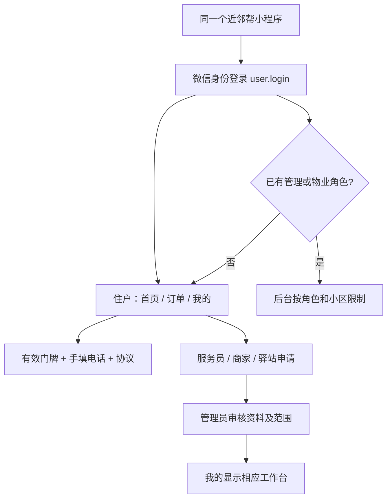
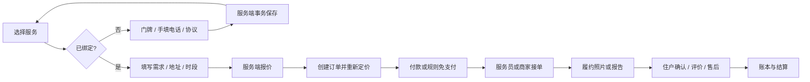
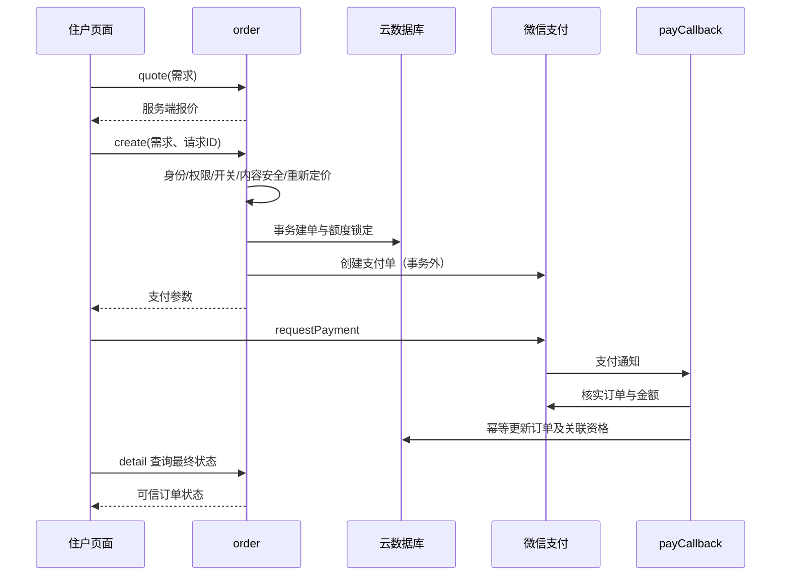
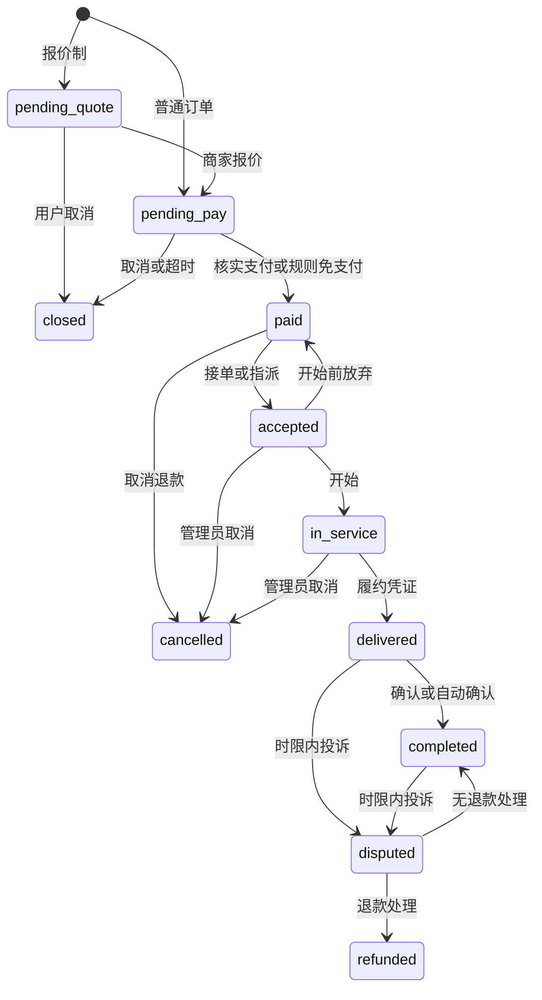
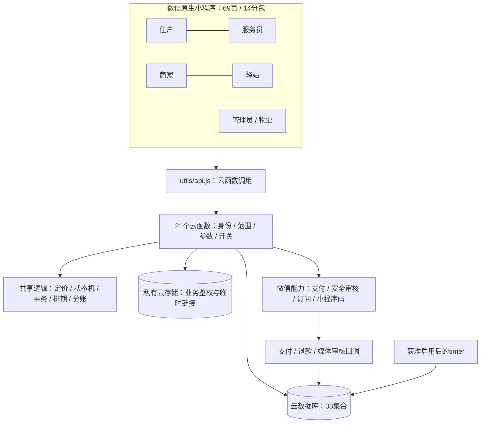
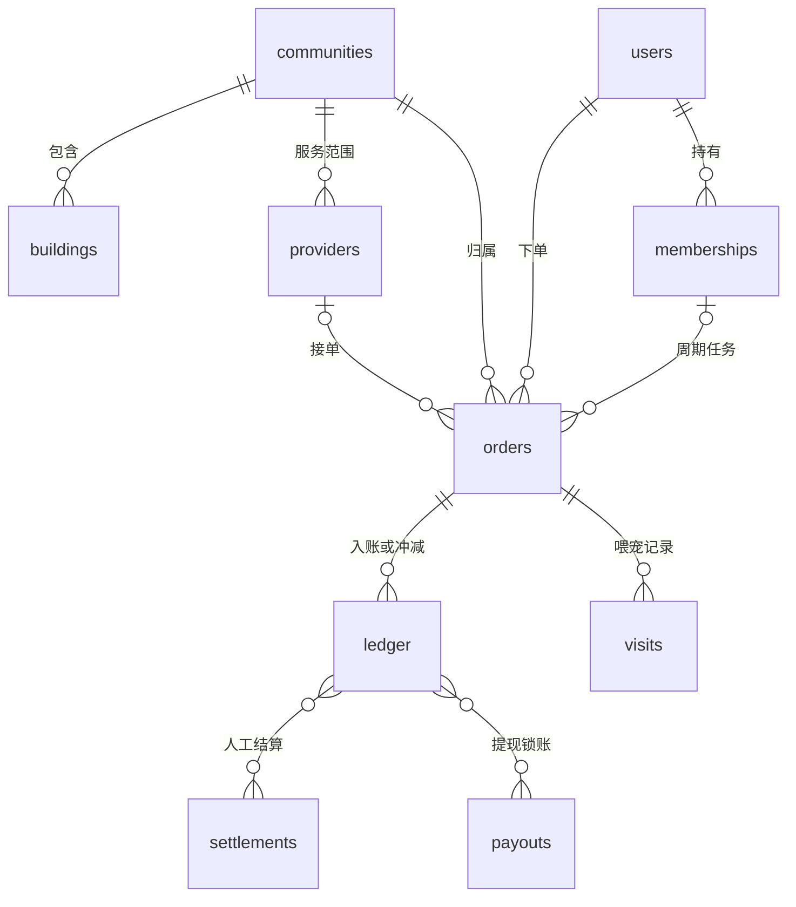
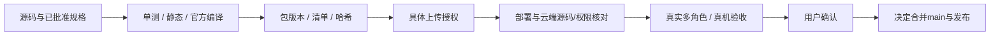

# NeighborLink（近邻帮）

英文项目名为 **NeighborLink**，仓库与代码标识使用 `neighborlink`。

仓库：[SourceSeeker-SameOrigin/neighborlink](https://github.com/SourceSeeker-SameOrigin/neighborlink)。

以小区为单位的上门服务与邻里互助微信小程序。住户找人取快递、扔垃圾、代买、帮把手；经审核的服务员、商家、驿站协作履约，管理员与物业按各自权限处理运营和售后。

**当前为开发联调阶段，尚未完成全量验收或正式上线。** 源码有69页、14分包、21个云函数；源码完成、云端部署、实景测试、用户验收是四种不同状态。main 未自动合并。

## 文档导航

|需要了解什么|入口|
|---|---|
|交付日期、工时与剩余工作|[交付排期：目标11月14日20:00](docs/DELIVERY_PLAN.md)，当前条件验收版；D05/D06继续暂缓|
|完整产品介绍|[可编辑 PPTX](docs/product/jinlin-product-introduction.pptx) · [PDF预览](docs/product/jinlin-product-introduction.pdf)|
|每个云函数做什么、在哪里调用|[21函数及69页调用索引](docs/product/CLOUD_FUNCTIONS.md)|
|每个页面的UI、操作和前置条件|[69页完整验收册](docs/product/PAGE_ACCEPTANCE.md)|
|跨角色业务验收|[测试交接](docs/TEST_HANDOFF.md) · [T00–T33状态](docs/ACCEPTANCE.md)|
|需求与设计依据|[SPEC](docs/SPEC.md) · [SPEC_EXT](docs/SPEC_EXT.md) · [批准设计稿](docs/design/approved-ui.png) · [设计规范](docs/design/DESIGN.md)|
|配置和待决事项|[人工配置](docs/MANUAL_SETUP.md) · [5W2H决策台账](docs/INTEGRATION_DECISIONS.md)|
|本轮证据|[11月11日最新69页续验](docs/verification/2026-11-11-ui-audit/README.md) · [此前整改与部署状态](docs/verification/2026-11-09-remediation/README.md) · [原始全范围核查](docs/audit/2026-11-09/README.md)|

## 所有功能从哪里进入

首页保留四项核心服务卡，并提供19项扩展服务与能力目录，统一显示“可使用／未开通／待完善资料”；已开放且资料齐全时直达对应页面。**目录可见不等于已开通**。真实业务入口受登录、绑定、开关、角色和记录权限约束；位置、积分、退款等能力嵌在业务页面内。

|功能|入口|前置条件|
|---|---|---|
|取快递、扔垃圾、代买、帮把手|首页四张服务卡|有效门牌与联系电话；交易条件|
|快递/垃圾月卡|首页月卡条、我的月卡|小区方案、支付、排期配置|
|独居探访、空房巡检|月卡页对应方案；订单详情看报告|elder / vacantHome；班次、报酬与入户配置|
|助老送餐、陪诊、喂宠、回收|已绑定首页的业务入口|elder / pet / recycle；定价与服务资格|
|求助、悬赏、出行帮带|需求广场|board；帮带另需 travelCarry；悬赏需支付|
|闲置发布、担保交易、卖家收入|闲置列表、我的闲置|idle；担保另需 idleEscrow|
|社区活动|活动列表/详情；组织者活动管理|events；公益免费，收费活动需支付|
|周边商家预约|商家列表→详情→预约|merchants；商家/服务已审，报价制先待报价|
|驿站批量配送|我的同意开关、驿站与配送工作台|stationDelivery；逐户同意与配送前复核|
|站内消息|我的消息、订单/闲置联系入口|chat；会话参与关系和有效期|
|优惠券、积分|领券/我的券、报价栏|coupons / points；积分依赖回收配置|
|自动提现|服务员收入、卖家收入|autoPayout；商户转账资格、密钥、余额|
|附近小区、服务员位置|选择门牌；订单详情地图|location、坐标、平台与设备授权|
|联合社区|支持模块的本区/联合社区切换|federation 与同组小区；付费悬赏仍限本区|
|公告、广告|首页、公告列表、配置的广告位|notices / ads；内容审核、有效期和投放范围|

全局是默认值，**小区显式布尔配置优先**。全局定位开启并不会撤销示例小区的 location=false。依赖：idleEscrow→idle、travelCarry→board、points→recycle；federation还需对应内容模块。当前没有为了让所有入口显示而自动打开其余开关。

## 一个账号如何进入五个端

五端是同一个小程序的不同工作区，不是五个独立小程序。微信云上下文识别登录身份，无需另设密码；手填电话仅是未验证的服务联系方式，不证明号码属于该微信用户。

|端|从哪里进入|如何取得资格|
|---|---|---|
|住户|首页 / 订单 / 我的三个tab|默认住户；业务前按需绑定门牌|
|服务员|我的→成为邻居帮手；通过后显示工作台|申请→管理员审核等级/证书/保险；值班再次检查|
|商家|我的→申请入驻；通过后商家工作台|商家开关开启→提交资料→管理员审核|
|驿站|我的→申请驿站账号；通过后驿站工作台|配送开关开启→选择合作驿站→审批授予角色与范围|
|管理员/物业|我的→管理后台|授权配置角色；普通住户不可自授。物业仅规格允许的本小区操作|

一个账号可持有多个获准角色，但本人切工作台不能替代多账号的越权与协作测试。D07已按用户明确授权完成本人开发管理员及告警名单配置，身份匹配、两处写入均已回读；真实会话刷新及七项管理读取已通过，“我的”入口已显示；管理看板已实际加载，13项导航及零数据统计已核对，筛选交互和完整业务仍待验收，不默认给其他登录者授予角色。



楼栋码 b=短码用于预选小区/楼栋，推荐码 r=短码用于来源归因；**扫码不会授予角色**。没有“扫不同端的码自动切换身份”这一授权流程。分享和直达页面仍须服务端鉴权。

## 住户下单与履约



D44：手填有效联系电话即可，不强制微信手机号授权；格式/保存失败保留输入，可返回首页，不循环强制进入绑定。D45：资料与绑定事件同事务；赠券异常单独提示“门牌已保存”，本人可幂等重试。旧云返回“请先授权手机号”应按部署版本排查。



前端支付成功提示不直接改订单。模拟支付同时要求数据库模式和云环境变量允许，本轮不自动开启。金额统一为整数分；服务费、商品款分别退款与对账。示例价不是对真实小区的商业承诺。



待报价不自动过期。关闭扩展后，新增交易/履约受限；授权历史查看、原规则允许的取消/投诉/退款以及支付退款回调、补偿继续。详见SPEC_EXT E20。

## 技术架构与数据



前端原生WXML/WXSS/JavaScript，无UI组件库；后端Node.js云函数、云数据库、云存储与云调用，无独立网页后台。每个云函数有多个action，一个页面可调用多个函数，多个页面也可共用同一函数。全部职责见[函数说明](docs/product/CLOUD_FUNCTIONS.md)。



此图是业务关系概览，文档库通过ID关联，不表示有关系库外键。完整字段、索引和安全规则见[database](database/README.md)与两份规格。

- 身份取自微信上下文，不信任客户端的openid或roles。服务员按审核、等级、证书、保险和接单关系授权；物业限制小区范围。
- 所有业务写入由云函数执行。小区/楼栋公开可读，其他业务集合前端不可直接读写。
- 共享逻辑唯一源是cloudfunctions/_shared；生成的lib/shared不能直接改。
- 私有图片需业务记录与文件归属鉴权，目标链接600秒；真实过期行为必须实测，不以客户端计时替代。
- 入户密码加密、按订单/日期授权、读取审计、不持久缓存明文；密钥只放云环境变量。
- 事务/条件更新防重复接单与记账；外部支付调用在事务之外。

## 开发、部署与运行

```text
miniprogram/       页面、14分包、组件、工具、资源
cloudfunctions/   21个云函数；_shared共享逻辑
database/        权限、索引、示例种子（非真实运营数据）
scripts/          同步、资源与产品文档生成
docs/            规格、设计、证据、验收与产品资料
```

```bash
npm ci
npm test
npm run sync
node scripts/build-product-inventory.js
```

用微信开发者工具导入仓库根目录；核对project.config.json的miniprogramRoot/cloudfunctionRoot，按miniprogram/config现有加载方式配置开发环境。AppID、云环境、模板、商户与管理员参数见[MANUAL_SETUP](docs/MANUAL_SETUP.md)，不要把密钥写入代码或数据库。

开发/生产使用独立环境；当前仅准备开发环境，生产尚未创建。不要将种子数据覆盖已有业务库。先核对33个集合、权限及索引，再按具体清单部署。timer代码部署不等于批准启用触发器。



## 当前状态与定位

- 手填电话和D45已实现；110ebe8的8个函数包已获授权，实际进度见[部署记录](docs/verification/2026-11-08-ui/deployment-progress.json)。批准不等于部署成功。
- 用户批准全局定位开启、新增独立珺悦国际、保留示例花园。地址为天华大街9号院，纬度39.686298、经度116.313420，依据[高德地图](https://www.amap.com/place/B000A8ZKTD)。location保留lat/lng，locationGeo使用经度/纬度顺序；设备请求GCJ-02。
- 新小区暂未提供真实楼栋、价格、班次或人员；定位与小区选择不能冒充真实门牌下单通过。
- 之前一轮570项Jest、69页官方编译通过，6页有模拟器截图；这些只证明对应版本和场景。最新检查见[R01–R08整改记录](docs/verification/2026-11-09-remediation/README.md)。
- 授权云包已更新；真实运营配置、各端角色、非定位开关、内容安全/订阅/密钥、交易和周期任务、真机等仍有待办。D05、D06继续暂缓；D07已完成云端权限配置、真实会话刷新及七项管理读取已通过，“我的”入口已显示；管理看板已实际加载，13项导航及零数据统计已核对，筛选交互和完整业务仍待验收，完整缺口保留在验收册。

## 常见问题

|现象|核查顺序|
|---|---|
|手填后仍要求手机号授权|核对云端user及共享源码版本；不靠隐藏错误或伪造已验证状态解决|
|首页未显示所有功能|完整目录始终可发现；可用项直达，未开通说明、未绑定完善资料；工作台按角色进入|
|没有工作台|检查申请审批和角色范围，扫码不能授权|
|没有自动定位|全局/小区开关→坐标/GeoPoint→平台隐私与接口配置→设备授权；拒绝后应可手选|
|小区能选但没有楼栋|真实楼栋尚未配置，不用示例门牌冒充|
|部署成功但行为仍旧|云端下载逐文件哈希对比，并核对客户端环境|
|输入框/按钮文字偏下|检查原生输入框上下padding、按钮min-height和flex居中，并看实际截图|
|无交易/定时结果|核对资格、密钥、模式、回调、触发器，编译不能替代实测|

新增实质性决策按5W2H列出事实、选项和影响交用户确定；测试不自动授权付费、角色提升或合并main。

## 2026-11-09 已批准整改

R01–R05、R06 A、R07 A已更新规格及本地实现。管理配置包含管理员维护真实楼栋/单元，住户仍选择；看板服务费净收入与商品款分列；有效月卡锁定排期和额度。完整工作台从“我的→工作台与入驻”发现；管理员/物业须运营授权，不自助授予角色。

验证状态见[本轮整改记录](docs/verification/2026-11-09-remediation/README.md)。两批授权更新已全部完成：原8项含3个批准替代、新7项，去重12个函数、886/886源码文件一致，admin最后部署。当前无需再选代码包；真实绑定、跨角色业务和69页完整UI仍待验收，timer未调用或启用。

R08 已批准：待付款月卡订单也锁定计划权益；下单、激活与管理员修改通过小区版本参与事务冲突校验。相关写入端与admin版本均已部署；真实云端竞态仍待角色和数据齐备后验证。

## 开发分支与许可证

`develop` 用于汇总联调中的代码，不代表正式上线或全部验收通过。请以 [完整验收清单](docs/product/PAGE_ACCEPTANCE.md) 和 [联调记录](docs/TEST_HANDOFF.md) 中对应版本、场景的证据为准。

本项目采用 [MIT License](LICENSE)，版权署名为 `Copyright (c) 2026 SourceSeeker-SameOrigin`。第三方依赖仍适用各自许可证。
