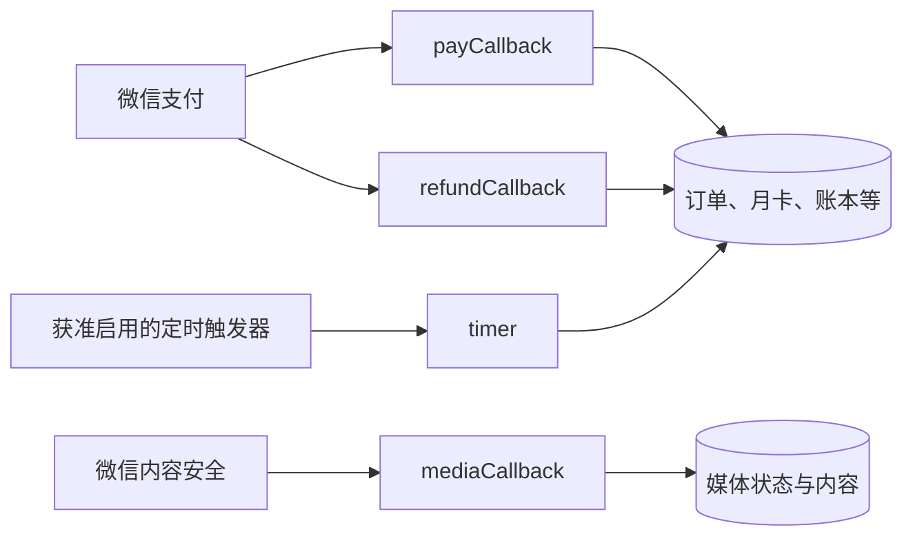

# 云函数用途与调用位置

云函数是在腾讯云运行的后端程序。小程序把操作交给它；它验证身份、权限、开关和参数，再读写数据或调用微信能力。小程序端不掌握支付密钥，也不能直接写业务数据库。

一个云函数包含多个 action。页面≠函数：一个订单详情会调用多个函数，多个下单页共用 order。21 个函数不是 21 个用户入口。以下用途人工核对入口源码；调用表按页面及其本地依赖的字面量 api.call 生成，并人工补齐当前6页动态分发目标；这是源码可达关系，不等于所有运行路径已实测。

|函数|作用|在哪使用|
|---|---|---|
|[user](../../cloudfunctions/user/index.js) · 身份与服务资料|微信登录、手填电话与门牌绑定、扫码来源、新人赠券重试|首页、绑定、我的、优惠券；全局应用及需身份的业务页面|
|[catalog](../../cloudfunctions/catalog/index.js) · 小区服务目录|小区/楼栋/价格/班次查询、附近3公里小区、楼栋与推荐码解析|绑定页、首页、全部下单页、管理配置|
|[order](../../cloudfunctions/order/index.js) · 交易主干|报价、创建、支付重试、列表详情、取消、确认、评价、投诉、报告订阅|核心/助老/回收等下单页、我的订单与详情|
|[provider](../../cloudfunctions/provider/index.js) · 服务员履约|申请、审核状态、值班、大厅、接单/放弃/开始/完成、收入、前台位置|服务员5页；订单详情展示履约结果|
|[membership](../../cloudfunctions/membership/index.js) · 周期服务|月卡方案、购买、我的月卡、跳过今天任务|月卡页；垃圾/快递/探访/空置房月卡共用|
|[admin](../../cloudfunctions/admin/index.js) · 运营与物业管理|看板、订单售后、服务员审核、小区/开关/楼栋、海报码、结算、导出|admin分包；物业只可操作规格允许的本小区功能|
|[board](../../cloudfunctions/board/index.js) · 邻里互助|求助、悬赏、出行帮带的列表、详情、发布、评论、关闭、举报|需求广场3页；悬赏交易复用order/provider|
|[idle](../../cloudfunctions/idle/index.js) · 闲置交易|信息发布、联系、担保购买、卖家接单交付、收入与商品状态|闲置7页；担保售后复用订单处理|
|[event](../../cloudfunctions/event/index.js) · 社区活动|创建/审核/发布、报名、签到、取消与异步退款任务管理|活动列表、详情、活动管理|
|[chat](../../cloudfunctions/chat/index.js) · 站内会话|打开会话、发送、拉取、未读、标记已读、授权审计查看|消息列表/聊天页、订单和闲置联系入口、后台审计|
|[coupon](../../cloudfunctions/coupon/index.js) · 优惠券|领券中心、领取、我的券、模板管理、管理员发券|优惠券2页、后台模板页；积分计算在共享交易/回收逻辑内|
|[payout](../../cloudfunctions/payout/index.js) · 提现转账|服务员/卖家提现申请、锁定账本、查询转账状态|服务员收入、卖家收入；启用autoPayout且商户配置齐备|
|[merchant](../../cloudfunctions/merchant/index.js) · 商家预约|入驻/审核、商家和服务查询、服务管理、预约报价与履约|商家4页、住户商家3页、后台商家审核|
|[station](../../cloudfunctions/station/index.js) · 驿站批量配送|账号申请审核、住户同意、创建批次、接批次、逐户复核、配送与对账|驿站5页、我的送上门开关、服务员大厅、后台驿站审核|
|[content](../../cloudfunctions/content/index.js) · 社区内容运营|公告、广告、曝光点击、确认广告收款、举报与内容/用户治理|首页、公告、广场/商家广告位、后台内容和举报页|
|[pet](../../cloudfunctions/pet/index.js) · 喂宠上门记录|每次上门任务、授权读取入户信息、完成或漏做记录|喂宠工作页/记录页；下单仍由order创建|
|[vacant](../../cloudfunctions/vacant/index.js) · 空置房报告|授权读取入户信息、提交逐项巡检报告、订阅报告|服务员任务详情、住户订单详情；购买复用membership|
|[timer](../../cloudfunctions/timer/index.js) · 定时补偿与排期|支付超时、未接单提醒、自动确认、月卡排期、退款/提现查单、活动退款分批等|后台定时触发；无独立页面，不可由普通用户调用|
|[payCallback](../../cloudfunctions/payCallback/index.js) · 支付结果入口|可信支付通知、查单校验、幂等更新订单/月卡/资格|微信支付系统回调；前端支付成功提示不能替代它|
|[refundCallback](../../cloudfunctions/refundCallback/index.js) · 退款结果入口|核实退款结果、幂等更新退款与关联业务|微信支付系统回调；用户从订单详情查看结果|
|[mediaCallback](../../cloudfunctions/mediaCallback/index.js) · 媒体审核结果|接收并核验异步图片审核结果，更新媒体可见性|平台消息推送；影响图片显示，无独立页面|

## 页面到后端的调用索引

全局应用及需身份的业务页面通过 app.ensureSession 共用 user.login；下表另列可静态追踪的业务调用（包含公用表单/支付辅助函数）。受分支控制的调用不代表打开该页就全部执行。

|页面|接口|
|---|---|
|P01 [近邻帮](../../miniprogram/pages/index/index.js)|catalog.getCommunity、content.adEvent、content.homeContent|
|P02 [选择门牌](../../miniprogram/pages/bind/bind.js)|catalog.getCommunity、catalog.listCommunities、catalog.nearbyCommunities、catalog.resolveScene、user.bindPhone、user.setAddress|
|P03 [代取快递](../../miniprogram/pages/service/express.js)|catalog.getCommunity、order.create、order.detail、order.mockPay、order.quote、order.subscriptionTemplates|
|P04 [代扔垃圾](../../miniprogram/pages/service/trash.js)|catalog.getCommunity、order.create、order.detail、order.mockPay、order.quote、order.subscriptionTemplates|
|P05 [周边代买](../../miniprogram/pages/service/buy.js)|catalog.getCommunity、order.create、order.detail、order.mockPay、order.quote、order.subscriptionTemplates|
|P06 [帮把手](../../miniprogram/pages/service/help.js)|catalog.getCommunity、order.create、order.detail、order.mockPay、order.quote、order.subscriptionTemplates|
|P07 [我的订单](../../miniprogram/pages/orders/list.js)|chat.list、order.listMine|
|P08 [订单详情](../../miniprogram/pages/orders/detail.js)|chat.open、order.cancel、order.complain、order.confirm、order.detail、order.mockPay、order.rate、order.retryPayment、order.subscribeVisitReport、order.subscriptionTemplates、vacant.subscribeReport|
|P09 [我的月卡](../../miniprogram/pages/membership/index.js)|membership.buy、membership.mine、membership.plans、membership.skipToday、order.detail、order.mockPay、order.subscriptionTemplates|
|P10 [我的](../../miniprogram/pages/me/me.js)|chat.list、merchant.myApplication、station.myApplication、station.setDoorDelivery|
|P11 [隐私政策](../../miniprogram/pages/legal/privacy.js)|无字面量业务调用；静态内容或共用登录|
|P12 [服务协议](../../miniprogram/pages/legal/terms.js)|无字面量业务调用；静态内容或共用登录|
|P13 [服务员申请](../../miniprogram/provider/apply/apply.js)|catalog.listCommunities、provider.apply、provider.myStatus、user.bindPhone|
|P14 [服务员工作台](../../miniprogram/provider/workbench/workbench.js)|order.subscriptionTemplates、provider.myStatus、provider.myTasks、provider.referralPoster、provider.setDuty|
|P15 [任务大厅](../../miniprogram/provider/hall/hall.js)|order.subscriptionTemplates、provider.accept、provider.hall|
|P16 [任务详情](../../miniprogram/provider/task/task.js)|order.detail、provider.deliver、provider.release、provider.start、provider.updateLocation、vacant.recordReport、vacant.revealEntry|
|P17 [我的收入](../../miniprogram/provider/earnings/earnings.js)|payout.create、payout.list、provider.earnings|
|P18 [管理看板](../../miniprogram/admin/dashboard/dashboard.js)|admin.dashboard、admin.notificationTemplates、catalog.listCommunities|
|P19 [订单管理](../../miniprogram/admin/orders/orders.js)|admin.exportSubsidyOrders、admin.listOrders|
|P20 [订单处理](../../miniprogram/admin/order/order.js)|admin.assign、admin.forceCancel、admin.listProviders、admin.resolveComplaint、admin.retryRefund、admin.voidMembership、order.detail|
|P21 [服务员审核](../../miniprogram/admin/providers/providers.js)|admin.cleanupProviderKyc、admin.listProviders、admin.reviewProvider、admin.setCerts、admin.setInsurance、admin.suspendProvider|
|P22 [小区配置](../../miniprogram/admin/community/community.js)|admin.managementConfig、admin.updateCommunity、admin.updateConfig、admin.upsertBuilding|
|P23 [海报码](../../miniprogram/admin/posters/posters.js)|admin.genPoster、admin.listProviders、catalog.getCommunity、catalog.listCommunities|
|P24 [结算](../../miniprogram/admin/settlements/settlements.js)|admin.exportCsv、admin.listProviders、admin.listSettlements、admin.settlementCreate、admin.settlementMarkPaid、admin.settlementPreview、catalog.getCommunity、catalog.listCommunities、merchant.adminList|
|P25 [功能开关](../../miniprogram/admin/features/features.js)|admin.getFeatures、admin.updateCommunity、admin.updateConfig、catalog.listCommunities|
|P26 [内容举报审核](../../miniprogram/admin/reports/reports.js)|content.listReports、content.moderateContent、content.moderateUser、content.resolveReport|
|P27 [聊天记录审计](../../miniprogram/admin/chat/chat.js)|chat.adminPull|
|P28 [优惠券模板管理](../../miniprogram/admin/coupons/coupons.js)|coupon.adminTemplates、coupon.manualIssue、coupon.saveTemplate|
|P29 [公告与广告管理](../../miniprogram/admin/content/content.js)|content.endAd、content.endNotice、content.listAds、content.listNotices、content.markAdReceived、content.saveAd、content.saveNotice|
|P30 [商家入驻审核](../../miniprogram/admin/merchants/merchants.js)|merchant.adminList、merchant.adminServices、merchant.review、merchant.setServiceStatus|
|P31 [回收企业月度对账](../../miniprogram/admin/recycle/recycle.js)|admin.exportRecyclerStatement、catalog.listCommunities|
|P32 [数据导出](../../miniprogram/admin/exports/exports.js)|admin.exportCsv、admin.exportRecyclerStatement、admin.exportSubsidyOrders、admin.listProviders、catalog.getCommunity、catalog.listCommunities、merchant.adminList、station.exportStatement|
|P33 [驿站账号审核](../../miniprogram/admin/stations/stations.js)|station.listApplications、station.reviewApplication|
|P34 [站内消息](../../miniprogram/chat/list/list.js)|chat.list|
|P35 [聊天](../../miniprogram/chat/room/room.js)|chat.markRead、chat.open、chat.pull、chat.send、content.report|
|P36 [优惠券中心](../../miniprogram/coupons/center/center.js)|coupon.center、coupon.claim|
|P37 [我的优惠券](../../miniprogram/coupons/mine/mine.js)|coupon.mine、user.retryWelcomeCoupons|
|P38 [需求广场](../../miniprogram/board/list/list.js)|board.list、catalog.getCommunity、content.adEvent、content.adsForSlot|
|P39 [求助详情](../../miniprogram/board/detail/detail.js)|board.close、board.comment、board.detail、board.report|
|P40 [发布需求](../../miniprogram/board/create/create.js)|board.create、catalog.getCommunity、order.detail、order.mockPay、order.subscriptionTemplates|
|P41 [闲置交易](../../miniprogram/idle/list/list.js)|catalog.getCommunity、idle.list|
|P42 [闲置详情](../../miniprogram/idle/detail/detail.js)|chat.openIdle、idle.buy、idle.contact、idle.detail、idle.markSold、idle.remove、idle.report、order.detail、order.mockPay、order.subscriptionTemplates|
|P43 [发布闲置](../../miniprogram/idle/create/create.js)|catalog.getCommunity、idle.create、idle.detail、idle.update|
|P44 [我的闲置](../../miniprogram/idle/mine/mine.js)|idle.mine|
|P45 [担保交易订单](../../miniprogram/idle/sales/sales.js)|idle.sales|
|P46 [卖家交付](../../miniprogram/idle/sale/sale.js)|idle.acceptSale、idle.deliverSale、order.detail|
|P47 [卖家收入](../../miniprogram/idle/income/income.js)|idle.earnings、payout.create、payout.list|
|P48 [社区活动](../../miniprogram/events/list/list.js)|event.list|
|P49 [活动详情](../../miniprogram/events/detail/detail.js)|content.report、event.cancelSignup、event.detail、event.signup、event.templates、order.detail、order.mockPay、order.subscriptionTemplates|
|P50 [活动管理](../../miniprogram/events/manage/manage.js)|event.adminList、event.cancelEvent、event.checkin、event.create、event.listSignups、event.publish、event.retryCancellation、event.review|
|P51 [上门喂宠](../../miniprogram/pet/order.js)|catalog.getCommunity、order.create、order.detail、order.mockPay、order.quote、order.subscriptionTemplates|
|P52 [喂宠上门清单](../../miniprogram/pet/work.js)|pet.listVisits、pet.markDone、pet.markMissed、pet.revealEntry|
|P53 [喂宠服务记录](../../miniprogram/pet/reports.js)|pet.listVisits|
|P54 [商家入驻](../../miniprogram/merchant/apply/apply.js)|merchant.apply、merchant.myApplication|
|P55 [商家工作台](../../miniprogram/merchant/workbench/workbench.js)|merchant.myApplication|
|P56 [服务管理](../../miniprogram/merchant/services/services.js)|merchant.myServices、merchant.upsertService|
|P57 [商家预约订单](../../miniprogram/merchant/orders/orders.js)|merchant.completeBooking、merchant.merchantOrders、merchant.merchantTransition、merchant.quoteBooking|
|P58 [社区商家](../../miniprogram/shops/list/list.js)|content.adEvent、content.adsForSlot、merchant.listForCommunity|
|P59 [商家详情](../../miniprogram/shops/detail/detail.js)|content.report、merchant.servicesForMerchant|
|P60 [提交预约](../../miniprogram/shops/booking/booking.js)|merchant.createBooking、merchant.lookupBooking、order.detail、order.mockPay、order.subscriptionTemplates|
|P61 [申请驿站账号](../../miniprogram/station/apply/apply.js)|station.applicationOptions、station.apply、station.myApplication|
|P62 [驿站工作台](../../miniprogram/station/workbench/workbench.js)|station.exportStatement、station.listMyBatches|
|P63 [创建送上门批次](../../miniprogram/station/create/create.js)|station.createBatch|
|P64 [驿站配送任务](../../miniprogram/station/worker/worker.js)|station.acceptBatch、station.providerHall|
|P65 [驿站批次](../../miniprogram/station/batch/batch.js)|station.checkDoorDeliveryConsent、station.providerBatch、station.recordDelivery、station.startBatch|
|P66 [送餐上门](../../miniprogram/elder/meal.js)|catalog.getCommunity、order.create、order.detail、order.mockPay、order.quote、order.subscriptionTemplates|
|P67 [陪诊预约](../../miniprogram/elder/escort.js)|catalog.getCommunity、order.create、order.detail、order.mockPay、order.quote、order.subscriptionTemplates|
|P68 [预约上门回收](../../miniprogram/recycle/order/order.js)|order.create、order.quote|
|P69 [小区公告](../../miniprogram/notices/list/list.js)|content.listNotices|

## 三类系统触发

部署了函数不等于触发器、回调或权限已配置。timer 的本轮授权仅更新代码，不启用触发器。不要在控制台随意模拟支付回调来代替真实交易验收。
