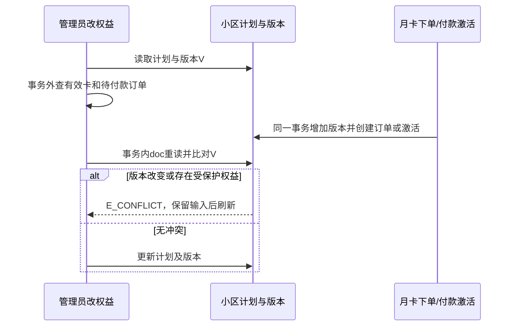

# 2026-11-09 当前整改、部署与验收状态

> 最新：QA09–QA13已全部批准A并实施，规格同步；605单测、76既有隔离回归、26项针对性回归（三时区）、207组页加载检查及官方编译通过。完整实景/成功业务仍待验，见[最新清单](../2026-11-09-all-pages/README.md)。D05/D06继续暂停；D07管理员、本人绑定及D13核心配置已完成，旧章节未完成描述保留为历史。

这是当前执行状态；[整改前完整审计](../../audit/2026-11-09/README.md)保留616条原始索引、34个任务、69页和40个场景，不用历史快照覆盖本页的新结果。原始规格ZIP未修改。当前分支 `fix/dev-integration`；main未合并。

**结论：R01–R08代码与规格已更新，本地回归通过；两批授权更新的12个函数已全部部署并回读886个源码文件一致，完整69页UI和跨角色业务尚未验收。不能称项目已经交付完成，也不提供虚假的完成百分比。**

| 5W2H | 当前结论 |
|---|---|
| What | 补完整目录/工作台、后台导航/普通配置表单/物业只读、举报与广告位、收入口径、月卡权益保护；更新产品资料和验收证据。 |
| Why | 解决原始审计F01–F14中已获批准的实现缺口，并防止本地测试与实际云端状态混淆。 |
| Who | 代理负责实现和技术验证；用户决定运营参数、真实账号/权限、付费及最终验收。 |
| When | 规格→代码→本地回归→授权包部署与源码回读已完成；后续具备真实角色和数据后逐页与跨端验收。 |
| Where | IdeaProjects/jinlin、本机微信开发者工具、仅 cloud1-d4gbpd8zx89564fb6 开发环境。 |
| How | 每项分别记录代码、本地验证、实际部署、实景验证；遇新取舍直接在对话列5W2H，不只写在文档中。 |
| How much | 52套605项单测、29项隔离入口回归、16项手填流程回归；69页/14分包结构与官方WXML/WXSS编译。无新增购买；云调用费用按已有套餐计量，本轮独立账单未知。 |

## 本轮追加：QA01–QA06、真实绑定与D13（当前状态）

| 项目 | 已完成 | 仍未完成 |
|---|---|---|
| 门牌与手填电话 | 管理员录入珺悦真实楼栋/单元；用户本人保存成功；强制刷新会话后绑定及manual/未验证状态保留 | 多地址、赠券异常重试、真机弱网等完整边界仍待验 |
| 管理读取 | 39/39真实只读组合通过；14个管理页完成加载，含筛选和部分错误恢复 | 当前业务列表为空；真实审核/发布/履约/结算、非空分页不能标通过 |
| QA01–QA03 | 中文优惠券字段、商家状态筛选、公告广告独立加载及小区选择；16项页面/实际云入口离线回归通过，实际界面部分通过 | 实际发券、已通过商家服务上架、发布公告/广告尚未执行 |
| QA04–QA06 | 7页价格栏空值修正、广告中文表单、首页可选url修正；实际快递无报价禁用与广告上/下半屏已看 | 四项核心服务有效报价价格栏已补实景；送餐/陪诊/喂宠价格栏、各屏宽/字体/键盘和全部69页仍未完成；平台警告仍存在 |
| D13 | 用户已确认全部核心价格/班次/站点及39元含30分钟；规格、按次计价及订单快照/三端展示已实现，6项页面/实际云入口离线回归通过 | 02a4470的order/admin均已部署，77+76=153文件一致；批准参数已保存回读，4项真实云报价、5项拒绝边界、4页报价通过；建单/履约、跨角色及真机仍待验 |
| 本地完整检查 | 52套605项单测、29项流程、16项手填、10项列表绑定回归；69页/14分包官方WXML/WXSS编译通过 | 本地替身不等于真实云业务；完整用户签收未完成 |

新证据：[真实观察](admin-binding-live-qa.json)、[管理表单回归](admin-ui-regression.json)、[D13回归](d13-regression.json)、[605项单测](qa-d13-jest-summary.json)、[官方编译](admin-ui-static.json)。云端既有12函数886文件回读结论仅适用于此前版本，新D13两包已部署，order 77/77、admin 76/76文件一致；清单见[d13-deployment-manifest.json](d13-deployment-manifest.json)，不能沿用旧“已部署”结论。

## 已批准整改逐项状态

| 决策 | 代码/规格 | 本地验证 | 云端/实景限制 |
|---|---|---|---|
| R01 后台导航、物业只读、日期与指标、待报价 | 已补13项后台导航、物业分成只读分支、日期和全类型月卡指标、pending_quote筛选 | 页面及实际云入口隔离回归通过 | admin已部署75文件一致，普通住户7项读取拒绝及看板拒绝/重试/返回实测通过；本人管理员读取与部分界面已测；物业及完整业务待验 |
| R02 完整目录与五工作台 | 首页4核心服务+19项扩展/能力目录，显示可用/未开通/待资料；我的展示5工作台与资格说明 | 路由完整、关闭不发业务请求、角色进入/普通用户拒绝通过 | 实际未绑定账号已看见目录/5工作台；管理/物业资格说明实点通过；不是获权或完整业务通过 |
| R03 普通配置与楼栋编辑 | 补价格、班次、站点、月卡、费率、热线、关键词及全局时限表单；已有楼栋带ID更新 | 输入校验、现有楼栋编辑、失败保留、全局草稿保留、机密字段不返回、物业拒绝通过 | admin已部署；珺悦真实楼栋/单元由管理员录入，住户仍选择；未编造真实资料 |
| R04 举报与管理契约 | 活动/商家/聊天举报入口，参与人/范围校验，operation管理字段；隐藏消息不泄露正文/会话摘要；管理员按案件查看并留审计 | 重复幂等、3个不同举报人阈值、商家隐藏、跨区/外人拒绝、禁言聊天拒绝、案件审计通过 | content/chat/merchant均已部署并回读一致；真实内容安全和多账号全链尚未验收。未声称所有UGC写路径的禁言规则全量通过 |
| R05 两处广告位 | board_top、shops_top展示、私有图片签发、有效期/审核/宿主开关、站内跳转与计数 | 600秒签发参数、有效筛选、关闭拒绝、曝光去重/目标白名单通过 | content已部署并回读一致；真实图片链接有效期/审核回调/真机重试待测；不自动确认广告收款 |
| R06 收入口径 | 已付款服务费减成功服务费退款；商品款已收/退款/净额单列；保持创建日期范围，非平台利润 | 纯逻辑与实际admin入口金额对照通过 | 真实账本对账待数据和角色；不改支付及分账 |
| R07 有效卡计划保护 | active且未到期时禁删计划及改服务/排期/额度/期限；新购价格可调 | 有效卡拒绝、价格可调、无有效卡可删通过 | 相关R08写入路径及admin均已部署，真实云事务仍待有角色和数据时验证 |
| R08 待付款权益保护 | 待付款月卡订单也锁权益；实际关闭后解除；下单/激活/配置共用membershipRevision冲突校验 | 查询与事务之间插入购卡/激活时拒绝旧保存；过期报价拒绝；免费购卡+激活及重放幂等通过 | membership/order/payCallback已先更新，admin已最后更新并回读一致；真实并发、热点写冲突率待测，不以部署代替并发验收 |

R07检查期间发现事务内where调用不符合官方SDK能力，已改为事务外筛选、事务内doc重读与共同版本写入；隔离替身现仅向事务暴露doc，不允许where。[官方事务能力说明](https://docs.cloudbase.net/database/transaction)。这仍不替代真实云端并发验证。

## 原审计F01–F14如何闭环

| 原缺口 | 当前状态 |
|---|---|
| F01/F05/F06/F10 | R01本地已整改且admin已部署；真实后台成功路径待验收 |
| F02/F03 | R02本地已整改，普通未绑定身份实景部分通过；有角色进入与业务待验 |
| F04 | R03本地已整改；真实楼栋已维护、本人绑定已成功；D13运营配置已保存回读及报价验证 |
| F07/F08 | R04本地已整改且相关新云包已部署；内容安全、多账号待验 |
| F09 | R05本地已整改；真实广告/图片/点击核账待验 |
| F11 | 两批授权范围全部更新：12个函数、886个源码文件一致，含原8项及3个批准替代；真实绑定及刷新持久化已验证 |
| F12 | 楼栋维护方式已确定为管理员录入；已录入珺悦2号楼/1单元，其余楼栋尚缺。定位已有启用/坐标证据，手机GPS及完整定位边界未验 |
| F13 | 仍未关闭：69页逐页对稿、多角色、成功/空/错误/大字体/大小屏仍需完整验收 |
| F14 | 当前入口、规格编号/电话字段、README、函数册、页面册、PPT已更新；旧审计/旧轮次明确标历史，不伪造旧测试结果 |

编号说明：原审计建议R06–R09分别是部署/资料/全量验收/文档；后续对话R06–R08是收入与月卡规则。以本页“已批准整改”名称识别，不能混为同一决策。

## 部署事实与顺序

1. 原 `110ebe8` 的8包授权仍有效，不重复索取授权。**user/provider/idle/board/timer直接部署完成5/8**，各72个源码文件逐字节一致；证据 [user](user-cloud-readback.json)、[provider](provider-cloud-readback.json)、[idle](idle-cloud-readback.json)、[board](board-cloud-readback.json)、[timer](timer-cloud-readback.json)。membership/order/merchant已由fc2a313新包替代部署，分别回读75/76/75文件一致，按原8项范围累计完成8项（其中3项由新包替代）；timer只更新代码，触发器与运行验收未执行。
2. 最后一个admin包已完成选择文件哈希核对、部署及75文件源码回读。当前没有待选择或待上传的已授权包；见[去重汇总](deployment-summary.json)。
3. 本轮新增云行为已更新 **membership、order、payCallback、content、chat、merchant、admin**：前三个落实月卡订单创建/付款激活的版本写入；content/chat/merchant落实举报、隐藏、广告；admin实现配置、指标及权益校验。admin已按顺序最后部署。
4. 原批的order/membership/merchant已获用户批准由新包替代，避免先传旧包再覆盖。原批5个直接更新及3个替代更新均已回读一致，不需重复上传。本轮7包具体清单已由用户明确批准（883229字节，源码fc2a313）；当前7/7均完成部署及回读；源码一致不等于业务验收通过。见[清单](deployment-manifest.json)与[执行进度](deployment-progress.json)。
5. 其余函数虽含同步生成的共享副本，但没有新增可达业务变化：mediaAccess新增分支仅content调用，chatFlow改动仅chat动作，ugc的merchant归属分支由content管理调用；mediaCallback没有调用该归属分支。membershipFlow的激活仅membership/order/payCallback可达；timer任务生成逻辑本轮未变。旧批已有修改的函数也已按授权更新或由批准新包替代。
6. 不启用timer触发器、不开放HTTP、不授予角色、不配置密钥、不购套餐、不合并main。部署成功提示不等于源码一致，更不等于真实业务已验收。

## 本轮验证证据

| 项目 | 结果/边界 | 证据 |
|---|---|---|
| Jest | 52套592项通过；共享纯逻辑测试 | [摘要](jest-summary.json) |
| 隔离实际页面/云入口 | 29/29；合成数据库/身份，无云写入，不是真实支付 | [脚本](flows.cjs) · [结果](flows.json) |
| 手填/失败/返回/绑定成功模拟 | 16/16；真实成功绑定及刷新持久化已验证 | [脚本](manual-phone.cjs) · [结果](manual-phone.json) |
| 静态与官方编译 | 69页、14分包、全部WXML/WXSS编译通过；详细计数以JSON为准 | [结果](static.json) |
| 样式规则扫描 | 69页无规则问题；不能代替逐页对稿与实景 | [结果](style-audit.json) |
| 实际开发工具 | 首页目录、我的工作台、管理资格提示、手填输入、示例楼栋、绑定返回首页；无角色或用户资料写入 | [观察与未测项](native-summary.json) |
| PPT | 27页可编辑；结构校验及PDF导出通过；本轮变化页7/22已目视核查，其他页沿用此前渲染核查 | [PPTX](../../product/jinlin-product-introduction.pptx) · [PDF](../../product/jinlin-product-introduction.pdf) |

工具热更新期间出现一次webview导航错误，手动编译后已测返回流程正常；未据此推断生产根因。开发工具灰度基础库与真机兼容仍单独待验。

## 完整待验收清单入口（不能删去未测项）

- [69页逐页册](../../product/PAGE_ACCEPTANCE.md)：每页U1–U7视觉、F1–F6功能，填角色、版本、数据、截图及结果。
- [T00–T33完整原审计任务表](../../audit/2026-11-09/tasks.csv)：结合本页整改增量，不以旧状态冒充当前。
- [40个业务场景](../../audit/2026-11-09/scenarios.csv)，另加[15次扩展全关回归与4次真实支付复测](../../TEST_HANDOFF.md)。
- [21云函数用途与页面调用](../../product/CLOUD_FUNCTIONS.md)，系统触发函数单列；函数存在不代表权限/回调/触发器已配置。
- [完整待配置5W2H](../../audit/2026-11-09/decisions.md)：保留D05–D32全部事项；已批准项按当前状态推进，不重复审批。

| 待完成事项 | 当前前置/谁负责 | 验收标准 |
|---|---|---|
| 真实手填绑定、重进持久化、赠券异常重试 | 本人手填有效电话/真实同意；可先用明确标记的示例小区 | 无授权手机号阻塞；成功后首页地址正确，失败不假成功；重进仍一致 |
| 珺悦楼栋/单元及运营配置 | D07本人开发管理员已配置、真实会话刷新及七项管理读取已通过，“我的”入口已显示；管理看板已实际加载，13项导航及零数据统计已核对，筛选部分已测，非空数据与完整业务仍待验收；管理员维护真实资料和业务值 | 住户可选择有效楼栋/单元；无虚构价格/班次；未配置有明确提示 |
| 五工作台与跨角色全业务 | 用户指定获同意账号、角色、小区；正式申请/审核 | 有资格进入、无资格拒绝；跨小区/不同订单互不可见；扫码不授予角色 |
| 定位完整链路 | 真机授权/拒绝/关闭系统定位与近远场景 | 同时核对全局和本区开关、中心坐标、附近列表、手选回退、共享停止 |
| 所有UI | 69页对应角色/数据与大小屏真机 | 对照批准图，状态栏/按钮/电话输入上下居中，无裁切；加载/空/错/键盘/大字体均测 |
| 模拟交易D05、门锁密钥D06 | 继续暂停 | 不绕过、不开启；恢复后按原5W2H逐项验 |
| 首管理员D07 | 已恢复且完成身份匹配、角色及告警名单配置；真实会话刷新及七项管理读取已通过，“我的”入口已显示；管理看板已实际加载，13项导航及零数据统计已核对，筛选部分已测，非空数据与完整业务仍待验收 | 仅开发环境，保留已有角色/告警收件人；刷新会话后验证后台访问，其他账号仍需独立越权验证 |
| timer、内容安全、私有媒体、订阅通知 | 分别授权运行/配置模板与平台能力；不因代码上传自动启用 | 幂等/失败续批/时限/权限/链接过期/拒绝订阅后可查看 |
| 真实付款退款与新版转账 | 主体/商户/平台能力/密钥及真实资金测试范围 | 付款到账、服务费商品款对账、退款回调、卖家上限与失败补偿 |
| 体验版、合并、生产 | 先完成验收，再由用户批准 | 指定版本及成员、main依赖合并、DEV/PROD隔离、生产mock关闭、备份恢复 |

以上“待验收”不是声称代码已没有缺陷；新缺陷按5W2H当面说明并按授权处理。原始材料/历史证据均保留。

补充校验：Git空白检查排除了原始审计差异文件 `baseline-current.diff`，其中空白上下文行是有效patch格式，保持原样；其余本轮变更通过检查。

以下逐函数段落保留当时的执行顺序；其中“剩余/待部署”是当时状态，当前两批已全部完成，以顶部和最终汇总为准。

## provider部署后真实只读联调

云端72文件与110ebe8授权包一致；当前真实住户的myStatus返回成功且无服务员资料，hall/myTasks/earnings均返回E_FORBIDDEN。见[调用证据](provider-live-smoke.json)。这验证了连接与无资格拒绝，不代表审核、接单、履约、收入成功路径已验收。该次provider核验后待部署为新7包加旧idle/board/timer，共10个函数更新（最新进度见下节），均已授权。

## membership部署后真实只读联调

fc2a313的membership已部署，75文件哈希全部一致。真实未绑定账号：mine成功且0张卡；plans返回E_INVALID_PARAM并提示先绑定有效小区。见[源码回读](membership-cloud-readback.json)、[调用证据](membership-live-smoke.json)。无购卡、付款、续期或配置写入；R08须待order/payCallback/admin更新后联合验证。该次membership核验后剩余新6包+旧idle/board/timer，共9个函数更新（最新进度见下节）。

## order部署后真实只读联调

fc2a313的order已部署，76文件哈希全部一致。真实账号listMine三个分组均成功空列表、hasMore=false；非法分组E_INVALID_PARAM。实际点击已完成/售后后正常空状态，当前模拟器尺寸下状态按钮上下居中；不外推到有订单、多页或真机。见[源码回读](order-cloud-readback.json)、[调用证据](order-live-smoke.json)。无订单/支付/退款写入；R08仍待payCallback/admin更新后联合验证。该次order核验后剩余新5包+旧idle/board/timer，共8个函数更新（最新进度见下节）。

## payCallback部署回读

fc2a313的payCallback已部署，75文件哈希全部一致，包含R08月卡激活版本写入；见[源码回读](payCallback-cloud-readback.json)。本次没有调用函数、模拟支付回调或进行真实资金操作，因此不记录运行时付款通过。membership/order/payCallback三个写入端已更新；admin尚待最后部署，真实并发和资金回调仍待前置条件及联合验收。该次payCallback核验后剩余新4包content/chat/merchant/admin与旧idle/board/timer，共7个函数更新（最新进度见下节），均已授权。

## content部署后真实只读联调

fc2a313的content已部署，75文件哈希全部一致。当前真实未绑定住户：homeContent成功返回空公告/广告；board_top、shops_top均返回E_FEATURE_OFF；非法广告位E_INVALID_PARAM；listReports、listAds均E_FORBIDDEN。见[源码回读](content-cloud-readback.json)、[调用证据](content-live-smoke.json)。验证了当前身份下的连接、关闭开关与管理权限拒绝；没有发布、举报、审核、广告曝光记账或收款写入，不代表绑定后的内容展示、举报处理及广告业务成功路径已验收。该次content核验后剩余新3包chat/merchant/admin与旧idle/board/timer，共6个函数更新（最新进度见下节），均已授权；admin最后部署，真实云并发仍待联合验收。

## chat部署后真实只读及页面联调

fc2a313的chat已部署，75文件哈希全部一致。真实未绑定住户：list返回E_FEATURE_OFF，pull缺少会话参数返回E_INVALID_PARAM，adminPull返回E_FORBIDDEN。消息页显示功能未开放，点击重试完成加载后保留正确提示，返回订单页正常；当前模拟器尺寸重试文字上下居中。见[源码回读](chat-cloud-readback.json)、[调用与页面证据](chat-live-smoke.json)。控制台0错误、累计10警告（含SharedArrayBuffer弃用警告，未宣称所有警告已清除）。没有创建会话、发送消息或标记已读；收发、隐藏/禁言及管理员案件审核成功路径仍待配置和资格。该次chat核验后剩余新2包merchant/admin与旧idle/board/timer，共5个函数更新（最新进度见下节），均已授权；当时计划admin最后部署。

## merchant部署后真实只读及权限联调

fc2a313的merchant已部署，75文件哈希全部一致，替代110ebe8对应旧包。当前真实未绑定住户的myApplication/listForCommunity返回E_FEATURE_OFF；myServices/merchantOrders返回商家未审核E_FORBIDDEN；adminList/adminServices返回管理权限E_FORBIDDEN；servicesForMerchant缺少商家参数返回E_INVALID_PARAM。实际进入商家订单页后，E_FORBIDDEN按既有api.js规则返回首页。见[源码回读](merchant-cloud-readback.json)、[调用证据](merchant-live-smoke.json)。控制台0错误、累计13警告，未宣称警告已全部清除。没有提交申请、审批或创建预约；审核通过后的服务管理、隐藏商家过滤、预约与交易成功路径仍待验。该次merchant核验后剩余idle/board/timer三个原授权包和新admin，共4个更新（最新进度见下节）；当时计划admin最后部署。

## idle部署后真实只读及页面联调

110ebe8原授权idle已部署，72文件哈希全部一致。真实未绑定住户list/mine/earnings返回E_FEATURE_OFF；detail返回先绑定门牌E_INVALID_PARAM；sales成功返回0条、hasMore=false；负数分页E_INVALID_PARAM。本人担保订单页正常空状态、卖家收入入口可见（未点击）、返回首页正常。见[源码回读](idle-cloud-readback.json)、[调用及页面证据](idle-live-smoke.json)。控制台0错误、累计15警告，未宣称警告已全部清除。没有发布、购买、交付、退款或结算；完整业务及有数据的权限/分页仍待验。该次idle核验后剩余原board/timer及新admin共3个更新（最新进度见下节），均已授权；当时计划admin最后部署。

## board部署后真实只读联调与发现的问题

110ebe8原授权board已部署，72文件哈希全部一致。真实未绑定住户的求助/悬赏/出行帮带list均返回E_FEATURE_OFF，detail提示先绑定门牌。见[源码回读](board-cloud-readback.json)、[调用及页面证据](board-live-smoke.json)。页面三类标签可见，当前尺寸按钮文字居中，返回首页正常；整改前未绑定直达时显示“小区不能为空或超出长度限制”且仍显示发布按钮；用户后续批准A并已修复，见下节独立回归记录。无帖子/评论/举报/悬赏写入。控制台0错误、累计17警告，未宣称所有警告已清除。该次board核验后剩余原timer和新admin共2个更新（最新进度见下节），admin最后。

### 已批准整改：未绑定直达列表的引导

| 维度 | 事实、建议和边界 |
|---|---|
| What | 需求广场实际显示参数错误且发布按钮可见；闲置列表代码有同类小区查询结构，尚需实测 |
| Why | 未绑定时先请求catalog.getCommunity，未提供明确绑定引导 |
| Who | 用户决策，代理执行及更新规格 |
| When | 2026-11-09已在对话批准A；整改与验证继续，不影响授权部署 |
| Where | board/list/list；idle/list/list待同类核查 |
| How | 推荐A：显示请先绑定小区门牌、主动绑定入口，未绑定不显示发布，不自动跳转；B暂不改。回归失败/返回/绑定成功刷新与已绑定功能开关 |
| How much | 预计15–30分钟修改及本地回归，不新增服务费用；真机另验 |

用户后续明确批准A，已同步SPEC/SPEC_EXT/TASKS及项目协作规则；代码与验证结果见下节。

## 未绑定列表引导：A方案实施与回归

需求广场和闲置列表均已改为主动绑定引导，缺少小区或楼栋时不请求小区/业务/广告，不显示发布或误导空列表；清除旧列表及分页。已绑定仍验证原开关与权限。沿用原绑定保存后返回首页，不改变用户资料或云代码。SPEC/SPEC_EXT/TASKS/.Codex规则已更新。

- [新流程测试](list-binding.json)：10/10，包括两页不完整绑定、取消返回、保存失败、合成保存成功后重进、关闭开关及登录失败重试；真实保存未提交。
- Jest52套592项通过；原29项隔离流程和16项手填回归再次通过。
- [静态及官方编译](list-binding-static.json)：69页/14分包、WXML/WXSS全部通过、0问题；全页样式规则扫描0问题，不等于全页视觉验收。
- [实际开发工具记录](list-binding-summary.json)：首次编译仍加载旧代码，清理此前已授权的编译缓存后重新编译；两页真实显示正确，实际点击绑定和取消返回正常，未自动跳转，发布按钮隐藏。
- 本次只改小程序端，不需要重新上传board/idle云函数；当时剩余timer及admin授权包继续，timer只更新代码、不启用触发器；最新进度见下节。

## timer代码部署与配置只读核查

110ebe8原授权timer已部署，72文件哈希全部一致；[源码及配置证据](timer-cloud-readback.json)。控制台状态正常，Node.js20.19、index.main、256MB、执行超时3秒；标准定时触发器与微信云开发触发器均显示暂无数据，HTTP路由暂无数据。仅上传代码及云端依赖安装，没有应用ZIP内触发器声明、修改配置或调用timer；不得记为关单、月卡任务、退款恢复、转账查询等运行验证通过。3秒超时及受控任务运行仍按原D09待决，在批准前保持停用。原8包范围现已完成全部代码更新（5个原包+3个批准替代包）；该次timer核验后新7包为6/7；后续admin已完成，最终状态见下节。

## admin最后部署与本轮最终汇总

admin所选ZIP为122938字节，SHA-256与授权清单一致；官方CLI回读75/75源码文件一致。当前真实未绑定普通住户调用dashboard、managementConfig、getFeatures、listOrders、listProviders、listSettlements、notificationTemplates均返回E_FORBIDDEN。实际看板显示“无权查看管理看板”，不展示后台导航和财务数据；重新加载仍拒绝，返回闲置列表后保留主动绑定引导。当前模拟器重试文字居中。控制台0错误，警告累计13→15，未逐条清除或分类；不声称无警告。见[源码证据](admin-cloud-readback.json)、[实际调用与页面证据](admin-live-smoke.json)。

| 批次/函数 | 源码版本 | 回读文件 | 状态 |
|---|---|---|---|
| user、provider、idle、board、timer | 110ebe8 | 各72，共360 | 5个原包已更新 |
| membership、payCallback、content、chat、merchant、admin | fc2a313 | 各75，共450 | 6个新包已更新，admin最后 |
| order | fc2a313 | 76 | 新包已更新 |
| 两批去重合计 | 上述两个已授权版本 | 886/886一致 | 12个函数代码更新完成 |

原8项中order/membership/merchant由批准的新包替代，因此原8项和新7项去重后是12项，不是15个函数。其余9个函数不在本次更新范围，不将此结果写成21个函数全部重新验收。没有调用timer/payCallback、启用触发器、授予角色、改密钥/套餐或合并main。完整未验收范围仍见本页清单及[交接表](../../TEST_HANDOFF.md)；真实绑定、管理配置、月卡并发、跨角色成功流程、69页完整UI、内容安全/通知和资金流程均不能因代码部署而标记通过。

## D07恢复：首个开发管理员

用户明确指定本人当前开发工具微信账号，并进一步授权展开这条本人记录、核对roles/openid及完成两处配置。小程序会话用户ID与云端记录匹配；按项目sha256派生规则再次确认openid一致。目标用户ID仅在证据中保留尾号16249b8，完整openid不入Git。云端roles由resident追加admin，blocked仍为false；config/global.adminOpenids由0人追加为同一账号1人，未覆盖其他成员、无重复。见[脱敏配置证据](d07-admin-setup.json)。

没有替用户绑定电话或门牌，没有改其他账号、支付/密钥、功能开关、定时器或生产。D05、D06继续暂缓。用户解锁后已刷新真实会话，返回resident/admin，“我的”显示管理员后台入口；managementConfig、dashboard、getFeatures、listOrders、listProviders、listSettlements、notificationTemplates七项读取均成功。配置返回2个小区，看板0订单，三类列表均为空。首次看板导航报navigateTo:fail timeout；重新编译并重建图形工具连接后，实际点击已打开admin/dashboard/dashboard。2026-11-09 13:39–13:40界面与截图确认13项管理导航、示例花园当日0订单/0付费、服务费流水及净收入¥0.00、商品款已收/已退/净额¥0.00、暂无有效月卡、来源与扩展统计零值，加载提示已消失。当前调试器0错误、8警告；可见警告涉及开发工具/基础库提示，未宣称全部消除。看板顶部导航及底部卡片已实景查看，中部文字从界面树核对；尚未完成设计稿逐项签收、日期/小区/联合范围筛选及非零账本核对。通知送达、管理写入和完整后台业务仍未验收。

## D13部署及真实报价追加（2026-11-09）

order/admin两包已完成，源码153/153文件一致，依赖均为wx-server-sdk 4.0.2。批准的珺悦价格、班次和北门站点通过admin.updateCommunity保存，再用managementConfig回读一致；未提交其他配置字段，rates保持空对象。

4项真实云报价与4页refreshQuote成功；快递两件含一件大件原价8元、首单1元，垃圾原价5元、首单1元，代买服务原价50元、首单1元另加10元商品预付，帮把手39元含30分钟。5项非法边界按预期拒绝。详见[d13-live-config-quotes.json](d13-live-config-quotes.json)、[admin源码回读](d13-admin-cloud-readback.json)。

QA07已获用户批准A并完成修改，文案明确预约以接单确认为准，不改业务规则。7个公共表单×3种值班状态共21项隔离回归、52套605项Jest通过。解锁后重新编译，四核心服务实际报价、新提示换行与底部价格栏均核对通过，累计0错误/9警告，原渲染错误未复现；根因未定，不声称已根治。证据见[本地回归](qa07-regression.json)、[四页实景](qa07-live-pages.json)。未创建订单或操作支付；D05/D06继续暂缓。
